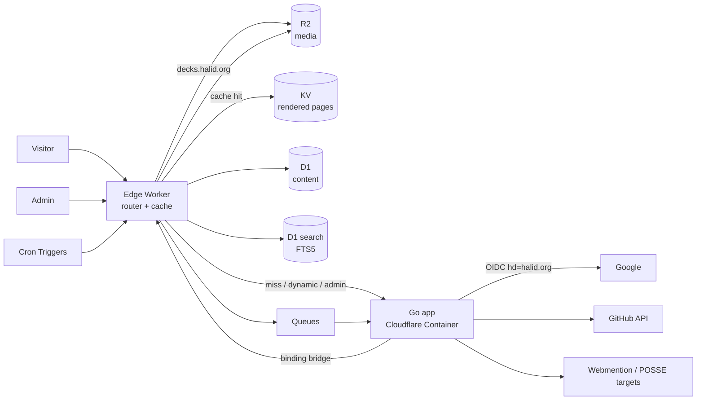

# Architecture

## 1. Topology



### Components

| Component | Responsibility |
|---|---|
| **Edge Worker** (thin, TypeScript) | Routing, KV page cache, static assets, R2 media, bridge to D1/R2/KV for the container (outbound interception of `bridge.internal`), cron fan-out |
| **Go app** (Container) | Admin UI, Markdown rendering, public SSR on cache miss, htmx endpoints, importer, sync jobs, OG image generation |
| **D1** | All content, relations, tags, i18n pairs, audit log |
| **D1 search** | FTS5 index in its own database, derived from D1 and rebuildable (ADR-010) |
| **KV** | Pre-rendered public HTML keyed by `lang:path`, feed XML, sitemap |
| **R2** | Images, attachments, OG images, exports |
| **Queues** | Async jobs: render, purge, GitHub sync, webmention send/receive, POSSE |

## 2. Request paths

**Public read (hot path)**
1. Worker looks up `kv:page:{lang}:{path}`.
2. Hit: return HTML with `Cache-Control` + ETag. No container involved.
3. Miss: forward to Go app, which renders, writes to KV, returns.

**Interactive fragments** (search, filters, radar, stream pagination): htmx requests to `/x/*`, served by the Go app, short edge cache where safe.

**Admin write** (implemented in Phase 1.3)
1. Save in admin → Go app writes D1 (revision; publish moves `published_revision_id`).
2. The write path snapshots the entry before the write (`jobs.RefOf`) and enqueues one `entry.changed` job. The container sends it through the bridge (`/queue/send`); the row in `job_runs` is written first.
3. The Worker's `queue()` handler delivers the message to `POST /internal/jobs` on the container (the Worker refuses `/internal/*` from the internet). 2xx acks; anything else retries with backoff, 3 times, then the DLQ.
4. The job first renders the entry's OG card (`render/og`, 1200x630 PNG) to R2 at `og/{lang}/{section}/{slug}.png`, deletes the card at the old key when the entry moved, was unlisted or deleted, and writes the per-language site cards (`og/{lang}/site-{hash}.png`) once per design version. Pages reference cards as `/og/...png?v={hash}`; the hash comes from the card's inputs, so handlers build the URL without reading R2. The Worker serves `/og/*` straight from R2 (immutable when versioned), never through the container.
5. The job computes affected paths (`jobs.Paths`: item, list, home, old and new tag pages and tag feeds, language feeds, sitemap, translations), renders each through the same mux in process and writes KV (`page:{lang}:{path}`, same metadata as the Worker). A path that no longer renders is deleted. Then it upserts or deletes the entry's row in the SEARCH database.
6. Public site never waits on a cold container for published content.

## 3. Key decisions (ADRs)

### ADR-001: Go runs in Cloudflare Containers, not Go/WASM in Workers
- **Status:** Accepted (2026-10-17)
- **Decision:** Go app in a Container; thin TypeScript edge Worker in front; published pages rendered on publish and served from KV.
- **Why:** goldmark + chroma (syntax highlighting) + `html/template` + image libs exceed comfortable WASM size limits; `syumai/workers` is experimental and its D1 support is alpha.
- **Trade-off:** container cold start. Mitigated by render-on-publish into KV so public reads skip the container.
- **Phase 0 spike must verify:** container access to D1/R2/KV (direct binding vs Worker bridge), cold start numbers, monthly cost at expected traffic.
- **Store access (decided 2026-10-17):** the container calls `http://bridge.internal/{d1,kv,r2}/...`; the Worker intercepts it (`outboundByHost`) and answers with its own bindings. No public route, no secret, traffic stays inside Cloudflare. Go client: `app/internal/store`. Numbers and open items: `docs/spike-phase0.md`.
- **Fallback:** if Containers prove awkward, move the public renderer into the Worker and keep Go only for admin.

### ADR-002: D1 is the source of truth, Markdown is the authoring format
- Store `body_md` and rendered `body_html` per revision. Re-render all on renderer upgrades via a job.

### ADR-003: Separate schema per content type
- A shared `entries` table (id, kind, slug, lang, status, timestamps) plus one table per kind for type-specific fields. Gives one place for routing, tags, search, stream, i18n, while keeping type fields strict.

### ADR-004: Server-rendered HTML + htmx
- No SPA. Progressive enhancement. JS islands only where needed (Tech Radar, Mermaid, search-as-you-type).

### ADR-005: Google SSO (OIDC) restricted to @halid.org for admin auth
- **Status:** Accepted (2026-10-17), supersedes the earlier Cloudflare Access proposal. Driven by the Admin Login design.
- **Flow:** `/admin/login` → Google OIDC (authorization code + PKCE, `hd=halid.org` as a hint) → `/admin/auth/callback`.
- **Server-side checks:** verify ID token signature and `aud`/`iss`, then require `hd == "halid.org"` **and** email domain `@halid.org` **and** `email_verified`. `hd` alone is never trusted. Optional allowlist of exact emails in `site_settings`.
- **Session:** opaque 256-bit token in a `Secure; HttpOnly; SameSite=Lax` cookie scoped to `/admin`, 12h lifetime. The `admin_sessions` row id is HMAC-SHA256(`SESSION_SECRET`, token), so a leaked table cannot be replayed as cookies.
- **Re-auth:** publish and delete require `last_reauth_at` within 10 minutes; otherwise redirect to Google with `max_age=0` and `claims={"id_token":{"auth_time":{"essential":true}}}` (Google has no `prompt=login`). The callback requires an `auth_time` inside the window and fails closed without one, so `auth_time` must be enabled for the OAuth client (`docs/environments.md`).
- **Errors:** non-halid account shows the rose-rule banner from the design. No password form anywhere.
- **Defense in depth:** staging also sits behind Cloudflare Access; prod admin may add it later without code changes.
- **Secrets:** `GOOGLE_CLIENT_ID`, `GOOGLE_CLIENT_SECRET`, `SESSION_SECRET` via `wrangler secret`.

### ADR-006: Revisions, not overwrites
- Every manual save creates a revision; consecutive autosaves (800ms debounce) coalesce into one. Published pointer moves on publish. Enables diff and rollback in admin.

### ADR-007: Presentation decks on an isolated origin
- Decks are self-contained HTML uploaded to R2 and served from `decks.halid.org`, never from `halid.org`.
- Embedded with `<iframe sandbox="allow-scripts allow-same-origin">` on the deck origin only; the main site keeps a strict CSP.
- Slide control from the outline uses `postMessage` with origin checks; decks without the listener still render, only the outline jump is lost.

### ADR-008: Light-only theme, prototypes are the visual source of truth
- No dark theme or toggle. Dark appears only as designed bands.
- `/design` holds the Claude Design handoff. DESIGN.md summarizes it; prototypes win on conflict.

### ADR-009: Third-party embeds behind a CSP allowlist
- 500px photo embeds and Credly links are the only third-party content. CSP `frame-src`/`img-src` allowlist covers 500px CDN and `decks.halid.org`.
- Photo grid renders a local thumbnail (`image_url`) first and loads the 500px embed only in the lightbox, so the grid stays fast and works if 500px is down.

### ADR-010: Search is D1 FTS5 in a separate database
- **Status:** Accepted (2026-10-17). Evaluation: `docs/search-decision.md`.
- **Decision:** an FTS5 index (`unicode61 remove_diacritics 2`) in its own D1 database, `halidorg-search-{env}`, binding `SEARCH`. The Worker queries it directly, so search needs no warm container. Rows are written on publish and the whole index can be rebuilt from the main database by a job.
- **Why separate:** D1 cannot export a database that contains a virtual table, which would break the nightly export of the main database. The search database holds only derived data and is not backed up.
- **Turkish:** Go folds `ı`, `İ` and `I` to `i` in both the indexed text and the query; SQLite leaves `ı` alone, so "ılık" and "ilik" would not match. No stemming: the palette searches by prefix (`küme*`).
- **Why not Pagefind:** admin search must cover drafts and private entries, which a public static index cannot, and Pagefind re-indexes the whole site on every publish.

## 4. Repo layout

```
/worker            edge worker (router, cache, bridge, cron)
/app               Go application
  /cmd/server
  /internal/content   per-kind repositories + validation
  /internal/render    markdown, highlight, mermaid, OG images
  /internal/admin     handlers + templates
  /internal/public    handlers + templates
  /internal/jobs      render, purge, github, webmention, posse
  /internal/importer  Ghost and others
  /web/templates      partials/ (header, footer, cover, palette), public/, admin/, <kind>/
  /web/static         css/tokens.css, css/app.css, fonts/ (self-hosted woff2), js/ islands
/design            Claude Design handoff (.dc.html prototypes + README), reference only
/migrations        D1 SQL migrations
/docs              this folder
wrangler.jsonc
Dockerfile
```

## 5. Environments

| Env | Domain | Data |
|---|---|---|
| local | `localhost` via `wrangler dev` + local container | local D1 |
| staging | `staging.halid.org` (Cloudflare Access + Google SSO) | separate D1/R2/KV |
| prod | `halid.org` | prod D1/R2/KV, daily D1 export to R2 |

## 6. Cross-cutting

- **i18n:** `entries.lang` + `translation_group_id`. URL scheme `/tr/...` and `/en/...`, default by `Accept-Language`, `hreflang` tags.
- **Search:** D1 FTS5 over title, summary, body text and tags, in a separate search database queried by the Worker (ADR-010).
- **Feeds:** RSS + Atom + JSON Feed per kind, per tag, and a combined feed.
- **Observability:** Workers Logs, structured JSON logs from Go, job outcomes in `job_runs` table, admin health page.
- **Backups:** nightly D1 export + full Markdown/JSON export to R2.
