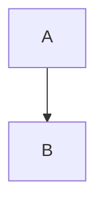

The admin for this site has one rule: a full page reload should never be necessary while editing.

## Why not an SPA

An SPA would duplicate the validation, the routing and the templates. Every form still works without JavaScript[^pe], which matters at 2am.

[^pe]: Progressive enhancement here means the plain form posts and redirects; htmx only intercepts when present.

## Autosave meets revisions

Autosave fires on `keyup changed delay:800ms`.

```go file=internal/admin/revisions.go
// coalesce autosaves
func (s *Store) SaveDraft(ctx context.Context) error {
	return nil
}
```

> [!TIP]
> Explicit saves (⌘S) always create a new revision. Only autosaves coalesce.

### Neden SPA değil? İşte cevap

```html file=editor.html tabs
<span id="status" hx-swap-oob="true">draft</span>
```

```go file=handler.go tabs
func save() {}
```

```terminal cwd=~/halid
$ go test ./internal/admin/... -run Revision
ok  	halid/internal/admin	0.412s
/tmp $ ls
```

> [!WARNING] dikkat
> OOB targets must exist on every page.

> Just a plain quote.

## Why not an SPA

Duplicate heading gets a suffixed id.

- a list item with a note[^li]

[^li]: Stays in the end list.


